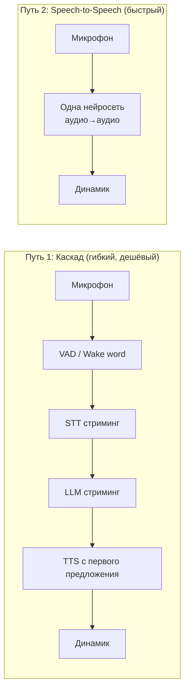

# Голосовой ассистент: исследование и выбор стека

> Дата: 20.09.2026
> Контекст: SynteeHelper, stage-05 (голос). Мозг — уже выбранная модель через syntee-gateway (бесплатно).
> Задача: полностью локальный, бесплатный голосовой контур (STT/TTS/VAD/wake word) с минимальной латентностью.
> Железо: AMD Ryzen 5 2600, 16 GB RAM, GTX 1660 6 GB, Windows 11.

---

## 1. Два пути архитектуры

| | Каскад STT→LLM→TTS | Speech-to-Speech (одна модель) |
|---|---|---|
| Латентность | 300–800 мс (облако) / 1.5–2 с (локально) | ~300 мс |
| Контроль | Полный: любой LLM, свои инструменты, память | Ограничен моделью |
| Цена | Дешевле (платишь за текст) | Дороже (платишь за аудио-токены) |
| Русский язык | Отлично | Зависит от модели |
| Агентные функции (тулы, память, скриншоты) | ✅ сохраняются полностью | ❌ сложно вкрячить |

**Порог естественности** — ~800 мс end-to-end. Дольше — разговор ощущается «по рации».

**Вывод: для Syntee (агентные тулы, память, скриншоты) — каскад.** Speech-to-speech отпадает: дорого, слабый контроль над агентным циклом.

---

## 2. Итоговое решение — локальный стек (всё бесплатно)

| Слой | Выбор | Размер | Ресурсы | Почему |
|---|---|---|---|---|
| **Wake word** | Vosk small-ru 0.22 | 45 МБ | CPU, ~2% | Ловит «Синти» офлайн, уже в плане stage-05 |
| **VAD** (конец фразы) | **Silero VAD v5** | 2 МБ | CPU, ~1% | Стандарт индустрии, ~1 мс на чанк. Заменяет тупой `silenceDuration: 1500` |
| **STT** | **faster-whisper small INT8** (GPU) | ~500 МБ | ~1 GB VRAM | В 4× быстрее оригинального Whisper, русский отличный, 5 с речи → ~0.3–0.5 с транскрипции |
| **TTS** | **Silero TTS v5** (голос xenia/kseniya) | ~60 МБ | CPU, ~300 МБ RAM | Лучший локальный русский голос, 10× быстрее реального времени на CPU — GPU не трогает |
| **LLM** | модель через syntee-gateway | — | — | Уже решено ✅ |

**Итого на диске:** ~700 МБ моделей (класть на D: или в appData — C: забит).
**Итого в памяти:** ~1.5 GB RAM + ~1 GB VRAM только в момент транскрипции.
**Запас VRAM:** ~5 GB свободно после загрузки STT.

---

## 3. Пайплайн и латентность

**~1.5–2 сек до начала озвучки** — для полностью локального бесплатного стека отличный результат
(облачные каскады ~1 с, но за деньги).

---

## 4. Обзор рынка STT (для справки)

### Облако

| Сервис | Латентность | Цена | Заметки |
|---|---|---|---|
| Deepgram Nova-3 / Flux | TTFT ~92–150 мс | $0.0077/мин стриминг | WER 5.26%, Flux имеет встроенный end-of-turn |
| ElevenLabs Scribe v2 | ~150 мс realtime | ~$0.004/мин | Отличный русский, лучшая точность среди мультиязычных |
| OpenAI gpt-4o-mini-transcribe | 300+ мс | $0.006/мин | Простой вариант, если уже юзаешь OpenAI |
| AssemblyAI Universal-3 | 300+ мс | $0.37/час | Хорошее форматирование, WER хуже (10.7%) |
| Google Chirp 3 / Azure | средняя | $0.72–1.0/час | 100–140 языков, для голосового бота избыточно |

### Локально

- **faster-whisper** — Whisper на CTranslate2, 4× быстрее оригинала, INT8 на GPU. **ВЫБРАНО.**
  - small (~500 МБ VRAM) — экономно и хорошо для команд
  - medium INT8 (~2 GB VRAM) — заметно точнее на длинных фразах
  - large-v3-turbo INT8 (~3 GB VRAM) — почти максимум качества, влезает в 6 GB
  - Апгрейд-путь без смены стека: small → medium → large-v3-turbo (просто другой файл модели)
- **whisper.cpp** — то же на чистом C++, есть биндинги под Node.js/Electron. Альтернатива для sidecar-подхода.
- **Vosk** — лёгкий (~45 МБ), CPU без нагрузки — идеален для wake word.
- **NVIDIA Parakeet** — open-source, догоняет облака по точности, очень быстрый.

---

## 5. Обзор рынка TTS (для справки)

Ключевая метрика — **TTFB/TTFA** (время до первого аудио-чанка).

### Облако

| Сервис | TTFB | Цена / 1М символов | Русский |
|---|---|---|---|
| ElevenLabs Flash v2.5 | ~75 мс | ~$180 | ✅ отлично |
| Cartesia Sonic 2/3 | ~90 мс (90 модель / 190 e2e) | ~$65–80 | ❌ в основном англ. |
| Murf Falcon | ~55 мс | средняя | ✅ 35+ языков |
| Gemini Flash TTS | ~250 мс | ~$12 | ✅ |
| OpenAI gpt-4o-mini-tts | ~300 мс | ~$80 | ✅ |

### Локально

- **Silero TTS v5** — лучший локальный русский голос (xenia/kseniya), быстрый, CPU-only. **ВЫБРАНО.**
- **Kokoro** (82M параметров) — очень быстрый и качественный, но **русского НЕТ**
  (только англ/яп/кит/хинди/фр/исп/итал/португ). Отпадает.
- **Piper** — сверхбыстрый, голоса ruslan/dmitri/irina, но звучит заметно роботичнее Silero.
  Запасной вариант, если Silero не взлетит.

---

## 6. LLM для голоса

Нужна модель с быстрым first token:

- **Модель через syntee-gateway** — уже выбрана, бесплатно. ✅
- Альтернативы (если понадобится): Gemini Flash (TTFB ~300–500 мс, дёшево, русский отличный),
  GPT-4o-mini / o4-mini, Claude Haiku.
- Бесплатные ресурсы: Z.AI (unlimited free), NVIDIA NIM.

---

## 7. Speech-to-Speech (максимальная скорость) — ОТКЛОНЕНО

- **OpenAI Realtime API** (gpt-realtime, GA с авг 2025) — аудио в/аудио out, ~300 мс, barge-in.
  Минус: дорого (аудио-токены, 1 токен = 100 мс аудио), слабый контроль над агентной логикой.
- **Gemini Live API** — дешевле, шире языки.
- **Inworld Realtime** — 220+ LLM за одним эндпоинтом, совместим с OpenAI SDK.

Причина отказа: агентные функции (тулы, память, скриншоты — ядро Syntee) в speech-to-speech
вкрячить сложно, а платить за аудио-токены незачем, когда есть бесплатный gateway.

---

## 8. VAD и определение конца фразы

Недооценённая штука — убивает больше скорости, чем модели:

- **Silero VAD** — крошечная (~2 МБ), CPU, определяет речь/тишину за миллисекунды. **ВЫБРАНО.**
- **End-of-turn в самой STT** (Deepgram Flux, Soniox) — модель сама понимает «человек закончил мысль»
  vs «запнулся», медиана <300 мс. Заменяет внешний VAD. Только облако.
- Фиксированный таймаут тишины (`silenceDuration: 1500`) — **плохо**: либо медленно, либо обрывает речь.

---

## 9. Фреймворки — НЕ НУЖНЫ

- **Pipecat** (Python, 12k+ ⭐) — конструктор пайплайнов STT→LLM→TTS со стримингом из коробки.
- **LiveKit Agents** (Python/TS, 10k+ ⭐) — то же + WebRTC-транспорт.

Для Electron-приложения избыточны — у нас свой транспорт (IPC + оверлей).
Но у Pipecat стоит подсмотреть паттерны: sentence-based TTS chunking, barge-in,
transport-агностичные сервисы.

---

## 10. Интеграция в Electron (как именно)

1. **Silero VAD + Silero TTS — через `onnxruntime-node`** (npm).
   Обе модели есть в ONNX, работают прямо в main-процессе Electron, без Python.
   Самый чистый путь.

2. **faster-whisper — как sidecar**:
   - вариант А: Python-скрипт, собранный в exe (PyInstaller);
   - вариант Б (проще): **whisper.cpp** с CUDA-сборкой как бинарник-сателлит —
     качаешь готовый бинарь, spawn'ишь процесс, скармливаешь wav — получаешь текст.
     Никаких зависимостей в рантайме.

3. **Воспроизведение — выкинуть PowerShell SoundPlayer** (блокирует поток, только WAV).
   Silero отдаёт PCM-чанки → гонять их в renderer через IPC и играть **Web Audio API**
   в оверлее. Даёт стриминг и мгновенный barge-in (перебил ассистента — звук погас за мс).

4. **Озвучка по предложениям**: копить токены LLM до `.`, `!`, `?` → сразу в TTS → в очередь плеера.
   Длинный ответ начинает звучать через секунду, а не после полной генерации.

---

## 11. Замены в плане stage-05

| Было в плане (stage-05-voice.md) | Заменить на |
|---|---|
| STT через gemini-3-flash (облако) | faster-whisper small INT8 локально (GPU) |
| TTS через облако (tts-1) | Silero TTS v5 локально (CPU, голос xenia) |
| `silenceDuration: 1500` | Silero VAD, порог ~400–500 мс |
| `powershell SoundPlayer` | Web Audio API в renderer (PCM-чанки через IPC) |
| `await tts.speakText(fullResponse)` после всего ответа | стриминг по предложениям (копить до `.!?`) |
| Vosk wake word | ✅ ОСТАВИТЬ как есть — идеален для своей задачи |

### Узкие места текущего кода из stage-05:

1. `VoiceSession.ts` (~строка 339): `await this.tts.speakText(fullResponse)` —
   добавляет к каждой фразе всю длительность генерации LLM.
   Нужно: перехватывать `response:token`, копить до конца предложения и отправлять в TTS сразу.
2. `silenceDuration: 1500` — заменить на Silero VAD, экономия ~0.5–1 с на каждой фразе.
3. `powershell SoundPlayer` — только WAV и блокирует поток; для стримингового TTS
   нужен буферизованный плеер (Web Audio API в renderer или node-speaker).

---

## 12. Главные правила скорости (важнее выбора моделей)

1. **Никогда не ждать полный ответ LLM для озвучки.** Делить стрим на предложения и гнать
   каждое в TTS сразу — экономит секунды на длинных ответах.
2. **Стриминг везде**: STT стримом, LLM стримом, TTS стримом (PCM-чанки).
3. **VAD с end-of-turn** вместо фиксированной тишины.
4. **Barge-in**: пользователь заговорил — мгновенно глушить TTS.
5. **Тёплые соединения**: держать процессы/сессии открытыми, не пересоздавать на каждую фразу
   (wake word процесс живёт в фоне, whisper-сателлит держится тёплым).

---

## 13. Резюме одной строкой

**Vosk (wake) + Silero VAD (конец фразы) + faster-whisper small INT8 на GPU (STT) +
Silero TTS на CPU (русский голос xenia) + бесплатная LLM через gateway =
полностью локальный, бесплатный голосовой ассистент с ответом за ~1.5–2 с
и запасом ~5 GB VRAM.**
