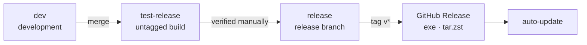

# Syntee Helper

[Русский](README.md) · **English**

A personal AI assistant for Windows and Linux: chat with any LLM, an agent with access to your files and terminal, MCP servers, plugins, long-term memory and voice.

> Version `1.1.7` · Electron 44 · TypeScript · React · Rust sidecar

---

## Features

### Chat and models
- Multiple providers in one window: [OI], Anthropic, Google, xAI, DeepSeek, Mistral, Groq, Cerebras, Cohere, Together, Fireworks, OpenRouter and local models via Ollama.
- Any compatible endpoint can be added as a custom provider.
- Chat branching and three modes: **Plan** (plan first, then edits), **Ask** (read-only) and **Auto**.
- Attachments: images, documents, audio. Built-in media analysis tools.
- Per-request cost and token accounting, plus a task summary panel.

### Agent
- Tools: read and edit files, code search (`search_code`), project map (`project_map`), command execution, diagnostics, document handling.
- **Code Mode** — run TypeScript scripts that batch dozens of tool calls into a single step.
- Sub-agents with isolated context and delegated chats for parallel work.
- **Dots** — background agents woken by schedule, file changes or a webhook.
- Tree-sitter project map: who calls whom, without reading whole files.

### Extensions
- **MCP servers** — local and remote, with timeouts and permissions.
- **Plugins** — JS modules that add tools, panels and notifications.
- **Skills** — markdown instructions selected by description.
- Built-in plugins for Office documents and plugin development.

### Environment
- Memory across sessions: user facts, project decisions, conventions, conversation outcomes.
- Semantic search and embeddings through the Rust sidecar (`syntee-sidecar`, ONNX Runtime).
- Built-in browser automation, window overlay, spotlight search, hotkeys, tray.
- Voice input and speech output.

---

## Install

| Platform | File |
|---|---|
| Windows | `Syntee-Helper-Setup-<version>-x64.exe` — installer, self-updating |
| Linux | `syntee-helper-<version>-x86_64.tar.zst` — portable archive |

Prebuilt binaries live in [Releases](../../releases) and are listed in `SHA256SUMS`.

For Arch Linux there is a `packaging/arch/PKGBUILD` — build the package with `makepkg -si` in that directory.

The Windows build updates itself: it downloads the installer in the background, closes the app and installs the new version.
The Linux build updates itself when installed from the archive; a pacman package updates through `pacman -Syu`.

---

## Build from source

### Requirements

| | Version |
|---|---|
| Node.js | 20+ (CI uses 24) |
| Rust | stable (`cargo`) |
| Windows | Visual Studio Build Tools (C++), Python 3 |
| Linux | `cmake`, `pkg-config`, `zstd`, `libnss3`, `libgtk-3` |

### Steps

```bash
git clone https://github.com/Lun13371/SynteeAgentDesktop.git
cd SynteeAgentDesktop
npm ci
```

Build the Rust sidecar (required — embeddings will not work without it):

```bash
npm run build:sidecar                 # Windows
bash Sidecar/scripts/build-linux.sh   # Linux
```

Build the app:

```bash
npm run dev        # development mode with hot reload
npm run build      # bundle into out/
```

Package:

```bash
npm run build:win            # Windows NSIS installer
npm run build:win:installer  # same, with environment checks
npm run build:linux          # Linux
```

### Scripts

| Command | Purpose |
|---|---|
| `npm run dev` | run in development mode |
| `npm run build` | build bundles |
| `npm run typecheck` | type check |
| `npm run lint` | ESLint |
| `npm run build:sidecar` | build the Rust sidecar |
| `npm test` | tests (Node test runner) |

---

## Architecture

```
src/
  main/        Electron main process: windows, IPC, tray, updates, managers
  core/        UI-agnostic logic: agent, LLM clients, database, memory,
               MCP, plugins, skills, Code Mode, project map
  preload/     IPC bridge to the renderer
  renderer/    user interface (React)
  shared/      types and tool schemas shared by every layer
Sidecar/       Rust service: embeddings, semantic search, ONNX Runtime
packaging/     Arch Linux packaging (PKGBUILD)
```

**Data flow.** The renderer talks to the main process only through the preload bridge. The agent lives in `core/agent` and calls tools through a single registry; LLM requests run in a separate worker so the UI never blocks. Heavy semantic work is offloaded to the Rust sidecar over HTTP.

**Updates.** A single source — GitHub Releases (`src/main/updater/releaseFeed.ts`). The app polls the feed every 30 minutes, downloads the new artifact in the background, verifies its SHA256 and runs the installer on user request (`src/main/updater/InstallerUpdater.ts`).

---

## Development



- `dev` — the main branch. Every push runs type check, lint, tests and a compile for Windows and Linux.
- `test-release` — release candidate. A push here builds artifacts without a tag and without publishing: download them from Actions and verify manually.
- `release` — releases only. Merge from `test-release`, then tag `v<version>` and CI builds and publishes everything.

The version comes from `package.json` and must match the tag, otherwise the release job fails.

### Tests

```bash
node --test "tests/*.test.cjs" "tests/*.test.mjs"
```

Some tests use native modules and require `xvfb` on Linux.

---

## Documentation

| File | Topic |
|---|---|
| `Sidecar/README.md`, `Sidecar/PROTOCOL.md` | Rust sidecar and its protocol |
| `docs/browser-automation.md` | built-in browser automation |
| `docs/agent-tools-media.md` | agent tools and media analysis |
| `docs/task-summary.md` | in-app task summary |
| `docs/GOAL_CONTEXT.md` | goals and context management |
| `resources/builtin-plugins/plugin-dev/docs/` | plugin development API |

---

## Feedback

Found a bug or have an idea? Open an [issue](../../issues). Pull requests are welcome — please open an issue first so we can agree on the direction.

---

## License

[MIT](LICENSE) © 2026 Lun13371

The code may be used, modified and distributed freely, including in commercial projects, provided the license text and copyright notice are preserved.
