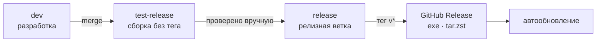

# Syntee Helper

**Русский** · [English](README.en.md)

Персональный AI-ассистент для Windows и Linux: чат с любыми LLM, агент с доступом к файлам и терминалу, MCP-серверы, плагины, память и работа с голосом.

> Версия `1.1.7` · Electron 44 · TypeScript · React · Rust sidecar

---

## Что умеет

### Чат и модели
- Несколько провайдеров в одном окне: OpenAI, Anthropic, Google, xAI, DeepSeek, Mistral, Groq, Cerebras, Cohere, Together, Fireworks, OpenRouter и локальные модели через Ollama.
- Любой совместимый endpoint добавляется как кастомный провайдер.
- Ветвление чатов, режимы **Plan** (сначала план, потом правки), **Ask** (только чтение) и **Auto**.
- Вложения: изображения, документы, аудио. Анализ медиа встроенными инструментами.
- Подсчёт стоимости и токенов по каждому запросу, сводка задачи в правой панели.

### Агент
- Инструменты: чтение и правка файлов, поиск по коду (`search_code`), карта проекта (`project_map`), запуск команд, диагностика, работа с документами.
- **Code Mode** — выполнение TypeScript-скриптов, которые батчат десятки вызовов инструментов за один шаг.
- Под-агенты с изолированным контекстом и делегированные чаты для параллельной работы.
- **Dots** — фоновые агенты, которые просыпаются по расписанию, по изменению файлов или по вебхуку.
- Карта кода проекта на tree-sitter: кто кого вызывает, без чтения файлов целиком.

### Расширения
- **MCP-серверы** — локальные и удалённые, с таймаутами и правами.
- **Плагины** — JS-модули, добавляющие инструменты, панели и уведомления.
- **Скиллы** — markdown-инструкции, подключаемые по описанию.
- Встроенные плагины: работа с Office-документами, разработка плагинов.

### Рабочее окружение
- Память между сессиями: факты о вас, решения проекта, конвенции, итоги диалогов.
- Семантический поиск и эмбеддинги через Rust-сайдкар (`syntee-sidecar`, ONNX Runtime).
- Автоматизация встроенного браузера, оверлей поверх окон, Spotlight-поиск, горячие клавиши, трей.
- Голосовой ввод и озвучка.

---

## Установка

| Платформа | Файл |
|---|---|
| Windows | `Syntee-Helper-Setup-<версия>-x64.exe` — инсталлятор, обновляется сам |
| Linux | `syntee-helper-<версия>-x86_64.tar.zst` — переносимый архив |

Готовые сборки — в разделе [Releases](../../releases). Все файлы продублированы в `SHA256SUMS`.

Для Arch Linux в репозитории лежит `packaging/arch/PKGBUILD` — собрать пакет можно через `makepkg -si` в этой папке.

Windows-версия обновляется сама: скачивает установщик в фоне, закрывает приложение и ставит новую версию.
Linux-версия обновляется сама, если установлена распаковкой архива. Для установки из локального Arch-пакета скачайте новый `.pkg.tar.zst` и обновите через `sudo pacman -U <файл>`.

Для сборок форка укажите `SYNTEE_RELEASE_REPOSITORY=owner/repo` перед сборкой. GitHub Actions подставляет текущий репозиторий автоматически. Для перехода со старого канала Windows на сборку форка один раз запустите её установщик из Releases.

---

## Сборка из исходников

### Требования

| | Версия |
|---|---|
| Node.js | 20+ (в CI — 24) |
| Rust | stable (`cargo`) |
| Windows | Visual Studio Build Tools (C++), Python 3 |
| Linux | `cmake`, `pkg-config`, `zstd`, `libnss3`, `libgtk-3` |

### Шаги

```bash
git clone https://github.com/Lun13371/SynteeAgentDesktop.git
cd SynteeAgentDesktop
npm ci
```

Собрать Rust-сайдкар (обязательно — без него не работают эмбеддинги):

```bash
npm run build:sidecar          # Windows
bash Sidecar/scripts/build-linux.sh   # Linux
```

Собрать приложение:

```bash
npm run dev        # режим разработки с hot reload
npm run build      # бандл в out/
```

Упаковать:

```bash
npm run build:win            # Windows NSIS-инсталлятор
npm run build:win:installer  # то же, с проверкой окружения
npm run build:linux          # Linux
```

### Скрипты

| Команда | Что делает |
|---|---|
| `npm run dev` | запуск в режиме разработки |
| `npm run build` | сборка бандлов |
| `npm run typecheck` | проверка типов |
| `npm run lint` | ESLint |
| `npm run build:sidecar` | сборка Rust-сайдкара |
| `npm test` | тесты (Node test runner) |

---

## Архитектура

```
src/
  main/        главный процесс Electron: окна, IPC, трей, обновления, менеджеры
  core/        логика без привязки к UI: агент, LLM-клиенты, БД, память,
               MCP, плагины, скиллы, Code Mode, карта проекта
  preload/     мост IPC → рендерер
  renderer/    интерфейс (React)
  shared/      типы и схемы инструментов, общие для всех слоёв
Sidecar/       Rust-сервис: эмбеддинги, семантический поиск, ONNX Runtime
packaging/     упаковка для Arch Linux (PKGBUILD)
```

**Потоки данных.** Рендерер общается с главным процессом только через preload-мост. Агент живёт в `core/agent` и вызывает инструменты через единый реестр; LLM-запросы уходят в отдельный worker, чтобы не блокировать интерфейс. Тяжёлая семантика вынесена в Rust-сайдкар по HTTP.

**Обновления.** Единственный источник — GitHub Releases (`src/main/updater/releaseFeed.ts`). Приложение раз в 30 минут проверяет фид, качает новый артефакт в фоне, сверяет SHA256 и по команде пользователя запускает установщик (`src/main/updater/InstallerUpdater.ts`).

---

## Разработка



- `dev` — основная ветка. На каждый пуш: проверка типов, линтер, тесты, компиляция под Windows и Linux.
- `test-release` — кандидат в релиз. Пуш сюда собирает артефакты без тега и без публикации: их скачивают из Actions и проверяют руками.
- `release` — только релизы. Мерж из `test-release`, затем тег `v<версия>` — CI соберёт и опубликует всё сам.

Версия берётся из `package.json` и должна совпадать с тегом, иначе релиз не начнётся.

### Тесты

```bash
node --test "tests/*.test.cjs" "tests/*.test.mjs"
```

Часть тестов работает с нативными модулями и требует `xvfb` на Linux.

---

## Структура документации

| Файл | О чём |
|---|---|
| `Sidecar/README.md`, `Sidecar/PROTOCOL.md` | Rust-сайдкар и его протокол |
| `docs/browser-automation.md` | автоматизация встроенного браузера |
| `docs/agent-tools-media.md` | инструменты агента и анализ медиа |
| `docs/task-summary.md` | сводка задачи в интерфейсе |
| `docs/GOAL_CONTEXT.md` | цели и управление контекстом |
| `resources/builtin-plugins/plugin-dev/docs/` | API для разработки плагинов |

---

## Обратная связь

Нашли баг или есть идея — создайте [issue](../../issues). Пул-реквесты приветствуются: сначала откройте issue, чтобы обсудить направление.

---

## Лицензия

[MIT](LICENSE) © 2026 Lun13371

Код можно использовать, изменять и распространять свободно, в том числе в коммерческих проектах, при условии сохранения текста лицензии и указания авторства.
